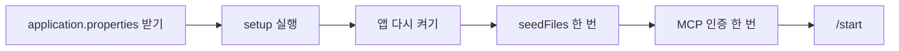
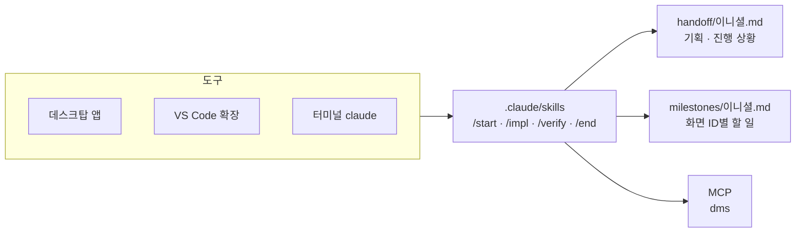
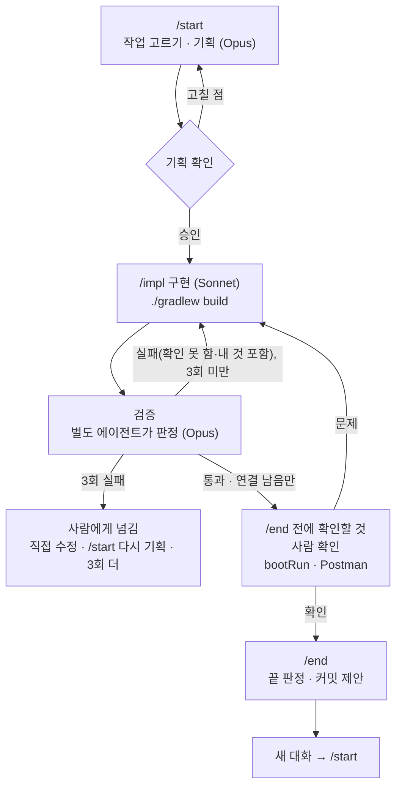
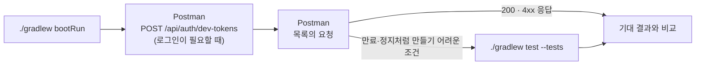

# 냥멍케어 백엔드

반려동물 케어 웹서비스 냥멍케어의 백엔드. Java 25, Spring Boot 4.1, MyBatis, MySQL 8.

- 규칙: `AGENTS.md`, 나머지는 `docs/convention/`
- 아직 정하지 않은 것: `docs/OPEN_ISSUES.md`

## 처음 받았을 때



### setup

| OS | 실행 |
| --- | --- |
| Windows | `setup.bat` (cmd·PowerShell·탐색기 더블클릭) |
| 맥 | `bash setup.sh` |

- 여러 번 실행해도 된다. 끝나면 IDE·데스크탑 앱을 다시 켠다(새 PATH 반영).
- Windows에서 `bash setup.sh`는 WSL이 떠서 안 된다. Codex를 쓰려면 Codex를 먼저 설치한다.

| setup이 하는 일 | 내용 |
| --- | --- |
| Git | 사용자 설정, 커밋 훅(`Co-Authored-By` 줄 삭제), 이니셜 브랜치 |
| AI 도구 | Claude Code·Codex 감지. 둘 다 없으면 Claude Code 설치 |
| IDE | VS Code·STS·둘 다 중 선택. 다시 고르려면 `setup.bat --ide` |
| JDK 25 | 없으면 설치 |
| VS Code | 확장(Java Pack, Spring Boot, Claude Code), JDK 등록 |
| STS | 없으면 설치, Lombok, 공용 포맷·UTF-8·LF |
| MCP | `dms`(요구사항정의서·화면설계서·기능명세서) |
| 확인 | 빌드, 공용 DB 접속, 서버 기동 |

직접 할 일:

- `application.properties`를 디스코드에서 받아 `src/main/resources/`에 둔다. 이름이 `.txt`로 바뀌지 않았는지 본다.
- STS는 처음 한 번 File > Import > Gradle > Existing Gradle Project로 `gradlew`가 있는 `backend` 폴더를 가져온다.
- `./gradlew seedFiles`를 한 번 실행한다(시드 이미지, "시드 데이터").
- DB 접속이 안 되면(학원 밖 등) setup이 할 일로 알려 준다.

### application.properties

비밀값이 들어 있어 git에 올리지 않고 디스코드로 공유한다. 키 목록은 커밋된 `application.properties.example`에 있다.

| 키 | 예 |
| --- | --- |
| `spring.datasource.url` | `jdbc:mysql://호스트:3306/PAWEVER` |
| `spring.datasource.username` | |
| `spring.datasource.password` | |
| `dms.mcp-url` | DMS MCP 서버 주소(claude.ai 커넥터로 `dms`가 연결돼 있으면 비워도 된다) |

- 키를 추가·변경하면 `application.properties.example`과 디스코드의 파일도 같이 고친다.
- `application-local.properties`(git 제외)가 있으면 그 DB 설정이 우선한다. 공용 DB의 시드 데이터를 보려면 이 파일을 두지 않는다.
- 운영 설정은 `application-prod.properties`(비밀값 없음, 커밋)에 둔다.

### MCP

- claude.ai 커넥터로 이미 연결돼 있으면 Claude Code에는 등록하지 않는다.
- 인증: Claude Code는 `/mcp` → 서버 선택 → Authenticate, 데스크탑 앱은 Connectors 화면(확인 필요), Codex는 `codex mcp login dms`.

### 직접 실행

```
./gradlew bootRun
```

- `http://localhost:8080`에 뜬다. 8080을 다른 프로그램(수업 프로젝트 등)이 쓰고 있으면 먼저 끈다.
- API 명세: `http://localhost:8080/swagger-ui.html`
- 한글이 깨지면 PowerShell에서 `chcp 65001`.
- `db/`의 SQL은 setup이 실행하지 않는다. 테이블을 바꾼 PR 작성자가 병합 직후 공용 DB에 실행한다(`docs/convention/shared-files.md`).

### 로그인 (dev-token)

로그인 API(YAY)가 나오기 전에는 회원 번호로 토큰 쿠키를 받는다(운영 프로필에서는 꺼진다). 번호는 "시드 데이터"의 계정 표를 본다.

- Postman: `POST http://localhost:8080/api/auth/dev-tokens`, Headers `X-Requested-With: XMLHttpRequest`, Body(raw JSON) `{"mbrSn": 1}` → 200. 쿠키는 Postman이 저장해 다음 요청부터 붙인다(요청 오른쪽 Cookies에서 확인·삭제).
- 브라우저: 프론트 화면(`http://localhost:5173`)의 개발자 도구 콘솔에서 실행하고 새로고침한다.

```js
fetch('/api/auth/dev-tokens',{method:'POST',headers:{'Content-Type':'application/json','X-Requested-With':'XMLHttpRequest'},body:JSON.stringify({mbrSn:1})})
```

- 토큰은 30분짜리다. 재발급 API가 아직 없어 만료되면(401, `/auth/refresh` 404) 다시 받는다.

### 프론트와 같이 띄우기

| 띄울 것 | 명령 | 포트 |
| --- | --- | --- |
| 백엔드 | `./gradlew bootRun` | 8080 |
| 프론트(`frontend` 저장소) | `yarn dev` | 5173 |

- 프론트는 `/api` 요청을 8080으로 넘긴다(`vite.config.js` 프록시). 두 포트가 꼭 8080·5173이어야 한다.
- 5173이 이미 쓰이고 있으면 Vite가 5174로 뜨고, 백엔드 CORS(`app.cors.allowed-origins`, 기본 5173)에 막혀 POST가 403(`Invalid CORS request`)이 된다. 5173을 쓰는 다른 프로젝트를 먼저 끈다.
- 로그인은 위 "로그인 (dev-token)"의 브라우저 방법. 이미지가 404면 `./gradlew seedFiles`를 실행한다.

### 시드 데이터

공용 DB에 화면 확인용 데이터(회원 200, 반려동물 1,000, 게시글 1,000 등 약 15만 행)가 들어 있다. 코드는 `src/seed`.

| 하고 싶은 것 | 명령 |
| --- | --- |
| 시드 이미지를 내 PC에 만들기(각자 한 번) | `./gradlew seedFiles` |
| 공용 DB에 넣기(빈 DB에 한 사람이) | `./gradlew seedData -Ptarget=shared -Pconfirm=<DB이름>` |
| 비우기(공용은 팀에 알린 뒤) | `./gradlew seedClean -Ptarget=shared -Pconfirm=<DB이름>` |
| 개인 로컬 DB에 넣기 / 비우고 다시 | `./gradlew seedData -Ptarget=local` / 뒤에 `-Preset` |
| 양 늘리기(1~20배) | `-Pscale=10` 추가 |

- 시드 대상 테이블에 행이 있으면 넣지 않는다. 고쳐서 다시 넣을 때는 `seedClean` → `seedData`. 둘 다 한 트랜잭션이라 실패하면 DB가 그대로다.
- `seedClean`은 시드 행만이 아니라 시드 대상·기록 테이블을 전부 비운다(팀원 테스트 데이터 포함). `COM_CD`·`NOTI_TMPLT`는 남는다.
- 공용 DB에는 이미지 행만 있어서 각 PC가 `seedFiles`로 파일(파일 저장 루트 아래 `seed/`·`public/seed/`)을 만든다. 남이 올린 이미지는 내 PC에 파일이 없어 404다. 공용 DB를 쓰면 `seedFiles`를 한 번 실행한다.
- 파일 저장 루트는 `app.file.root-dir`이다. 비우면 Windows는 프로젝트가 있는 드라이브 루트 아래 `home/ggorilab/attachment`(C:와 D:에 프로젝트를 두면 각 드라이브에 따로 생긴다), Mac은 `/Users/Shared/ggorilab/attachment`다. 서버를 켜면 로그에 `[FileRoot] 파일 저장 루트=…` 한 줄이 나온다. 예전 `uploads/` 폴더의 파일은 새 경로로 옮기거나 `seedFiles`를 다시 실행한다.
- `app.security.permit-all-paths`에 `/api/files/public/**`가 있어야 공개 이미지가 로그인 없이 열린다. 내 `application.properties`에 이 값을 직접 적었다면 추가한다.
- 사진은 `src/seed/resources/images`의 CC0 사진을 고른다. 사진을 바꾸면 같은 폴더 `SOURCES.md`에 출처를 적는다(표에 있는 사진만 쓴다). 영수증·검사결과지·픽셀 캐릭터·아이템은 생성기가 그린다.
- 같은 번호는 늘 같은 회원·반려동물이다. 날짜는 실행한 날 기준이다.
- 테이블 구조가 바뀌어도 생성기를 고치지 않아도 된다. 빠진 NOT NULL 컬럼은 타입·주석·공통코드 그룹·FK로 채우고, 없어진 컬럼은 빼고, 새 테이블은 자동으로 행을 만든다(못 넣으면 그 테이블만 건너뜀). 실행 끝의 "자동 처리" 경고를 보고, 화면에 어색한 값이 있으면 그 도메인 Seeder(`src/seed/java/com/nyangmeong/seed/domain/`)에서 다듬는다.

비밀번호는 모두 같고 `application.properties`의 `app.seed.password`에 있다(공개 저장소라 여기 적지 않는다). 로그인 API가 나오기 전에는 dev-token으로 들어간다.

| 회원 번호 | 이메일 | 용도 |
| --- | --- | --- |
| 1 | `tester@nyangmeong.dev` | 일반회원. 반려동물 3마리와 공동양육, 모든 화면에 데이터가 있다 |
| 2 | `admin@nyangmeong.dev` | 관리자 |
| 3 | `empty@nyangmeong.dev` | 반려동물 0마리(빈 화면 확인) |
| 4 | `full@nyangmeong.dev` | 반려동물 10마리(등록 상한 확인) |
| 5 | `operator@nyangmeong.dev` | 관리자 |
| 6~ | `user0006@nyangmeong.dev` 형식 | 일반회원. 정지·탈퇴 회원이 섞여 있다 |

넣지 않는 테이블: `COM_CD`(기준 SQL), `NOTI_TMPLT`(없으면 코드의 기본 문구), `RFRSH_TKN`·`LGN_ATMPT_LMT`·`EML_CERT`·`NOTI_SNDNG_LOG`(실행 중 쌓이는 기록).

## AI로 작업하기



| 도구 | 시작 |
| --- | --- |
| 데스크탑 앱 | [다운로드](https://claude.com/download) → Code 탭 → New session → Local, 이 폴더 |
| VS Code 확장 | 이 폴더 열기 → 왼쪽 막대의 Claude 아이콘 |
| 터미널 | 이 폴더에서 `claude` |

셋 다 같은 스킬과 MCP를 쓴다. STS만 쓰면 VS Code 확장(`anthropic.claude-code`)은 직접 설치한다.

### 작업 흐름



| 할 일 | 입력 |
| --- | --- |
| 다음 작업 시작 | `/start` |
| 특정 화면 시작 | `/start COM-003` |
| 기획 승인 (구현·검증 루프 시작) | `승인` 또는 `/impl` |
| 다시 검증 (직접 고친 뒤) | `/verify` |
| 마무리 | `/end` → `확인` → `커밋` → `푸시` → (마일스톤이 끝나면) `PR`. 병합은 GitHub에서 사람이 |
| 중간 저장 | `/end` → (확인 없이 `진행`으로 남김) → `커밋` → `푸시`. 다음은 `/start`로 이어 간다 |
| 새 대화 | 터미널·VS Code `/clear`(VS Code는 확인 필요, 안 되면 Open in New Tab), 데스크탑 앱 Ctrl+N |

- 마일스톤 파일이 없으면 첫 `/start`가 먼저 만든다(시간이 더 걸린다). 스킬이 `/` 목록에 없으면 새 대화를 연다.
- 모델은 바꾸지 않는다. 기본 Sonnet, `/start`와 검증만 Opus.
- 마일스톤 `끝`은 `/end`만 정한다. 남의 API·화면을 기다리는 "연결 남음"은 `끝`을 막지 않고 마일스톤과 핸드오프 "다음에 할 것"에 남는다(`docs/convention/milestone.md`).
- Codex(`$start`·`$impl`·`$end`)도 같은 흐름이다. 다른 점: 검증도 GPT로 돈다(Opus 지정은 Claude Code 전용). 기준 파일 잠금 훅(`.codex/hooks.json`)은 처음 폴더를 열 때 "신뢰" → `/hooks`에서 승인해야 돈다(훅이 바뀌면 다시 승인).

### 사람 확인

`/impl`이 끝에 주는 "`/end` 전에 확인할 것"(직접 `/verify`를 돌렸으면 그 보고)의 "사람 확인" 목록대로 확인한다. Postman은 데스크톱 앱을 쓴다(웹 버전은 `localhost`에 닿지 않는다).



1. `./gradlew bootRun` → `Started … in N seconds`가 나오면 준비 완료(공용 DB, "application.properties" 참고).
2. Postman 컬렉션 Variables에 `baseUrl` = `http://localhost:8080`. 요청 주소는 `{{baseUrl}}/api/...`.
3. 로그인이 필요하면 "로그인 (dev-token)"의 Postman 방법으로 쿠키를 받는다.
4. 목록의 요청(메서드·URL, Headers, Body)을 그대로 보낸다. POST·PUT·PATCH·DELETE에는 `X-Requested-With: XMLHttpRequest`(없으면 403 `FORBIDDEN`).
5. 응답 코드와 JSON을 기대 결과와 비교한다. 화면 확인은 "프론트와 같이 띄우기"대로 띄운다.
6. Postman으로 만들기 어려운 조건(만료 토큰·정지 회원 등)은 목록의 테스트로: `./gradlew test --tests '<클래스>'`, 결과 `build/reports/tests/test/index.html`.
7. 확인용으로 만든 데이터는 목록의 정리 방법대로 지운다(공용 DB). Postman Cookies의 `localhost` 쿠키도 지운다.
8. 목록의 "바뀐 파일"을 훑어보고 기획에 없는 파일이면 문제로 답한다. Ctrl+C로 끈다.

Swagger(`http://localhost:8080/swagger-ui.html`)에서 API 목록과 요청·응답 모양을 볼 수 있다. 쿠키와 `X-Requested-With`가 필요한 요청은 Postman으로 확인한다.

## PR 전 확인

```
./gradlew build
```

테스트는 DB에 붙지 않는다.
